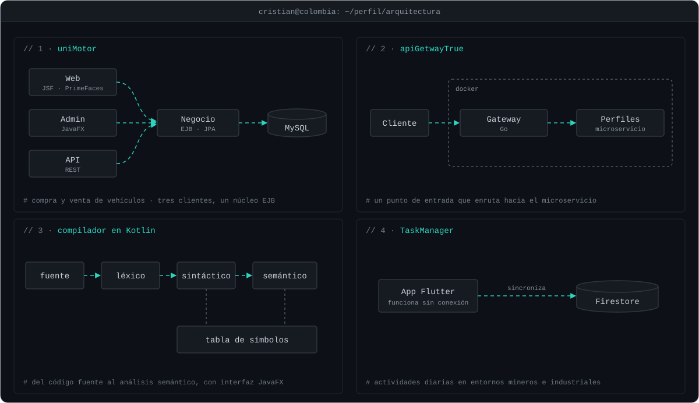

<p align="center">
  
</p>

## `GET /sobre-mi`

Desarrollador backend en Colombia. Desde diciembre de 2024 mantengo aplicaciones empresariales en **JEE y Spring sobre Oracle y PL/SQL**, con servicios SOAP y REST desplegados en JBoss y WebLogic. Cuando toca frontend: JSF, Angular o React.

## `GET /proyectos`

| Módulo | Qué hace | Stack |
|---|---|---|
| [`uniMotor`](https://github.com/CristianBastidas99/uniMotor) · [demo](https://unimotor.onrender.com/proyecto-web/) | Compra y venta de vehículos: cliente web, app de escritorio para el administrador y API REST | `Java EE` `JSF` `JavaFX` `MySQL` |
| [`impulso`](https://github.com/CristianBastidas99/Software_3_Plataforma_Literaria_Impulso) | Plataforma literaria con seguridad por roles, correos en segundo plano y panel de administración | `Spring Boot` `JSF` `MySQL` |
| [`unishop`](https://github.com/CristianBastidas99/UniShop) | Tienda en línea multimódulo: persistencia, negocio y web | `Spring Boot` `REST` |
| [`task-manager`](https://github.com/CristianBastidas99/TaskManager) | Registro de actividades sin conexión en entornos mineros, con sincronización | `Flutter` `Firestore` |
| [`api-gateway`](https://github.com/CristianBastidas99/apiGetwayTrue) | Gateway dockerizado frente a [un microservicio de perfiles](https://github.com/CristianBastidas99/apiGestionPerfiles) | `Go` `Docker` |
| [`compilador`](https://github.com/CristianBastidas99/Analisador_Lexico_Compiladores) | Análisis léxico, sintáctico y semántico con tabla de símbolos | `Kotlin` `JavaFX` |

## `GET /arquitectura`

<p align="center">
  
</p>

## `GET /experiencia`

```json
[
  { "rol": "Desarrollador junior", "desde": "2024-12", "hasta": null, "stack": ["JEE", "Spring", "Oracle", "PL/SQL", "JSF"] },
  { "rol": "Full Stack freelance", "desde": "2024-07", "hasta": "2024-12", "foco": "sistemas para conjuntos residenciales" },
  { "rol": "Ing. de Sistemas y Computación", "lugar": "Universidad del Quindío", "egreso": 2025 },
  { "rol": "Diplomado en infraestructura de TI y seguridad", "lugar": "Universidad del Quindío", "egreso": 2024 }
]
```

## `GET /actividad?limit=5`

<!--START_SECTION:activity-->
<!--END_SECTION:activity-->

## `GET /contacto`

[LinkedIn](https://linkedin.com/in/cfbastidaso) · [X](https://x.com/cristia99787343) · [todos los repos](https://github.com/CristianBastidas99?tab=repositories)

<sub>`200 OK` · respuesta servida en español; inglés disponible en nivel B1.</sub>
